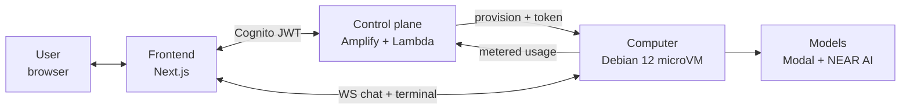

# Wayfind SWARM: AI teams, ready for hire

Wayfind SWARM lets you hire a team of AI bots instead of prompting a chatbot. Each team runs on its own cloud
computer (Debian 12 microVM) with baked-in dev skills, a terminal, a live website preview, and connectors to your
real tools.

It gives you an always-on AI workforce. You hire a Software Development team: a chief of staff who plans and
delegates, builders who write code, and a QA engineer who opens a real browser and tests what the builders
shipped, using Kane CLI. You chat, attach files, approve shell commands, answer questions, and watch the preview go
live. The team handles planning, building, and verification; you just direct.

## Highlights

- **Your own cloud sandbox.** Every user gets a persistent Debian 12 microVM (wayfind-cloud) — the team's computer,
  terminal, and file workspace in one place.
- **Hireable AI teams.** A chief of staff plans the work and delegates to builder bots, with team-scoped rosters
  and no runaway loops.
- **Skills baked into the image.** Five packs ship in the golden image — backend, frontend, Vercel best practices,
  and the Kane CLI skill — zero per-run setup.
- **QA bot with Kane CLI.** Ash opens headless Chromium and tests the live preview end to end, reporting pass/fail
  with the bugs found.
- **Live preview links.** Signed, 15-minute URLs to the dev server or built output, straight from the computer's
  endpoint.
- **Models and testing, managed for you.** Builder AI models and Kane CLI test runs need no keys or separate accounts
  from you — everything bills through the one usage meter.

## Quick links

- Platform: https://www.wayfind.click

## The problem

Getting AI to do real work today gives you three bad options:

- **Prompt a chatbot.** It forgets everything, can't run code, can't open a browser, and can't prove anything works.
- **Wire up agents yourself.** That needs sandbox infrastructure, model operations, skill packaging, and browser
  automation glue that most teams do not have.
- **Run automation tools by hand.** Browser-testing CLIs are powerful, but you're the operator: set up the
  environment, write the notebook or script, run it, read the output, decide what broke. The tool does the clicking;
  you do everything around it.

Wayfind SWARM is the middle path. You hire a team, it gets its own computer with real tools, and a QA bot verifies
the work in a real browser before calling it done.

## Live preview, straight from the cloud

Builder bots don't just write code — they run it, and you can open the running app in your browser:

- **`npm run dev` on the computer is the server.** The dev server starts on a port inside the same Debian 12 microVM
  and is exposed through the computer's Lambda endpoint.
- **One link, new tab.** Mint a preview link and it opens live: the dev server while iterating, or the built output
  when it's ready.
- **Signed and short-lived.** Links are HMAC-signed and die after 15 minutes.

The preview isn't just for you to click through — it's the same live app Ash tests against in the next section.

## QA bot with Kane CLI

Once the preview is live, Ash — the team's QA engineer — checks it the way a human QA would: in a real browser.
Ash is equipped with the Kane CLI skill and binary, so he tests the running app end to end and flags what works and
what has bugs.

**How it works:**

1. **Builders ship.** The team's builder bots write the app and serve it on the
   computer's dev port — the same port your preview link opens.
2. **Ask Ash directly.** Open Ash's chat — or mention him from any other bot — and tell him what to verify. He is
   hired with the `kanecli-skill` in his allowlist, so the skill is in his context from the first message.
3. **Ash tests in headless Chromium.** Ash drives the baked `kane` binary against the baked Chromium on the
   same image, headless. He loads the skill's references, runs the checks against the live preview, and reports
   pass/fail — with the bugs he found — back in the chat.
4. **Auth stays server-side.** The platform's Kane Cloud credential is injected as a secret; the
   computer server logs in at boot. Ash never sees credentials and never runs login himself.

**Why baked in, not installed per run:** the skill pack (25 files: SKILL.md, references, scripts) and the `kane`
binary ship inside the golden MicroVM image, so every fresh computer — and every Ash — has them with zero setup.
Proven live: a fresh boot reports all 5 skills including `kanecli-skill`, and a headless `whoami` + `debian.org`
check passed in 16.1s.

Implementation: `computer/workspace/skills/kanecli-skill/`, `computer/scripts/image/Dockerfile` (Debian + Chromium +
kane), team preset in `frontend/lib/teams.ts`.

## Try it (judge path)

Website: https://www.wayfind.click/app. Demo account: `pisuthd@outlook.com` / `Demodemo@1234` 

1. **Sign in.** Your cloud computer boots automatically (watch the status pill).
2. **Hire the team.** Open the team picker and import *Software Development* — chief, builders, and Ash (QA).
3. **Give it work.** Ask the chief to build something small, e.g. "build a mini-calculator with Vite and show me the
   preview." Attach files if relevant, approve shell commands when asked, answer batched questions with Send.
4. **Watch QA happen.** Ask: *"Ash, run the mini-calculator through kane-cli in a real browser and report
   pass/fail."* Ash tests it headless in Chromium and reports back in the thread.
5. **Check the preview.** Mint a signed preview link (dev server or built output, 15-minute expiry) and open it in a
   new tab.

Chat streams live over websocket with a polling fallback; the run pill above the composer shows elapsed time and warns
(`last update Xs ago`) if a run goes quiet, so a working bot never looks frozen.

## Architecture

### System overview

One persistent computer per user — no nested sandboxes:

- **Browser frontend** (`frontend/`, Next.js 15): landing, chat, roster, terminal, preview, connectors, usage.
- **Control plane** (`wayfind-cloud`, baseline): Cognito auth, `wayfind-api` Lambda, DynamoDB rows, S3 sync buckets.
- **Computer** (`computer/`, this repo): the agent server baked into a Debian 12 MicroVM image — run lifecycle,
  skills, MCP, terminal, preview relay, usage reporting.

Two repositories:

| Repo | Holds | Role |
|---|---|---|
| `wayfind-swarm` (this repo) | Website (`frontend/`), computer image (`computer/`) | Hackathon submission |
| `wayfind-cloud` | Amplify Gen 2 backend: Cognito, `wayfind-api`, DynamoDB, S3 | Baseline infrastructure, not submitted |

### Models

Each bot runs on one of these, selectable per bot (GLM is the default):

| Provider | Model | Notes |
|---|---|---|
| `modal` (default) | `GLM-5.3 Flash`, `Muse Spark Open` | Primary provider |
| `near` | `Claude Haiku 5.5`, `GPT-6 Luna` | Secondary provider from NEAR AI |

### Trust boundaries

| Boundary | Rule | Enforced by |
|---|---|---|
| Browser → control plane | Cognito JWT; computer calls use short-lived port-8080 tokens | `verifyToken` gate + `computerToken` mint |
| Agent → shell | Nothing runs unapproved | Approval-gated `shell` tool, allow-all is per-run only |
| Agent → spend | $1 free credit per account, sends refuse past the cap | Frontend-enforced `MONTHLY_CAP_USD` + ledger |
| Agent → Kane Cloud | Platform credential only, agent never logs in | `KANE_*` secret env + boot-time auto-login |
| Preview → public | Signed URLs, 15-minute expiry, no WS upgrade | HMAC-signed preview tokens |

### Code map

- Website (landing, chat, roster, terminal, preview, connectors, usage): `frontend/`
- Agent server (runs, providers, tools, terminal, preview relay): `computer/src/`
- Image pipeline (build, provision, probes, Kane e2e): `computer/scripts/image/`
- Baked seed (providers catalog, skill packs incl. kanecli-skill): `computer/workspace/`

## License

MIT. See [LICENSE](LICENSE).
