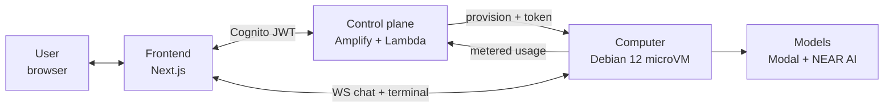

# Wayfind SWARM: AI teams, ready for hire

Wayfind SWARM lets you hire a team of AI bots instead of prompting a chatbot. Each team runs on its own cloud
computer (Debian 12 microVM) with baked-in dev skills, a terminal, a live website preview, and connectors to your
real tools — Zoho apps and Solana wallets included.

It gives you an always-on AI workforce. You hire a Software Development team: a chief of staff who plans and
delegates, builders who write code, and Ash — a QA engineer who opens a real browser and tests what the builders
shipped, using Kane CLI. You chat, attach files, approve shell commands, answer questions, and watch the preview go
live. The team handles planning, building, and verification; you just direct.

## Quick links

- Platform: https://swarm.wayfind.click/app
- Backend repo (baseline, not submitted): https://github.com/tamago-labs/wayfind-cloud
- Kane CLI (powers our QA bot): https://github.com/testmuai/kane-cli

## The problem

Hiring AI help today gives you three bad options:

- **Prompt a chatbot.** It forgets everything, can't run code, can't open a browser, and can't prove anything works.
- **Wire up agents yourself.** That needs sandbox infrastructure, model operations, skill packaging, and browser
  automation glue that most teams do not have.
- **Do without.** The work stays manual, slow, and dependent on individual people.

Wayfind SWARM is the middle path. You hire a team, it gets its own computer with real tools, and a QA bot verifies
the work in a real browser before calling it done.

## QA bot with Kane CLI

This is our Kane CLI hackathon entry point: an AI QA engineer that tests AI-built software the way a human QA would —
in a real browser — using the official Kane CLI skill and binary.

**How it works:**

1. **Builders ship.** The team's builder bots write the app (e.g. a React + Vite mini-calculator) and serve it on the
   computer's dev port.
2. **Chief delegates.** The chief of staff hands the verification task to Ash, the QA Engineer, via `message_bot`.
   Ash is hired with the `kanecli-skill` in his allowlist, so the skill is in his context from the first message.
3. **Ash tests in Chromium.** Ash drives the baked `kane` binary (`0.10.6`) headless against the baked Chromium on the
   same Debian 12 image: `kane --agent --headless` with `KANE_CLI_USER_AGENT=wayfind-qa`. He loads the skill's
   references (objectives cookbook, execution controls, evidence rules), runs the checks, and reports pass/fail back
   in the chat.
4. **Auth stays server-side.** The platform's `KANE_USERNAME` / `KANE_ACCESS_KEY` are injected as secrets; the
   computer server auto-runs `kane-cli login` at boot. Ash never sees credentials and never runs login himself.

**Why baked in, not installed per run:** the skill pack (25 files: SKILL.md, references, scripts) and the `kane`
binary ship inside the golden MicroVM image, so every fresh computer — and every Ash — has them with zero setup.
Proven live: a fresh boot reports all 5 skills including `kanecli-skill`, and a headless `whoami` + `debian.org`
check passed in 16.1s.

Implementation: `computer/workspace/skills/kanecli-skill/`, `computer/scripts/image/Dockerfile` (Debian + Chromium +
kane), team preset in `frontend/lib/teams.ts`.

## Try it (judge path)

Website: https://swarm.wayfind.click/app. Demo account: `pisuthd@outlook.com` / `Demodemo@1234` (shared Cognito pool —
same account as Wayfind ONE — or use your own account).

1. **Sign in.** Your cloud computer boots automatically (watch the status pill).
2. **Hire the team.** Open the team picker and import *Software Development* — chief, builders, and Ash (QA).
3. **Give it work.** Ask the chief to build something small, e.g. "build a mini-calculator with Vite and show me the
   preview." Attach files if relevant, approve shell commands when asked, answer batched questions with Send.
4. **Watch QA happen.** Ask: *"Ash, load the kanecli-skill and verify the mini-calculator in a real browser, then
   report pass/fail."* Ash runs Kane headless in Chromium and reports back in the thread.
5. **Check the preview.** Mint a signed preview link (dev server or built output, 15-minute expiry) and open it in a
   new tab.

Chat streams live over websocket with a polling fallback; the run pill above the composer shows elapsed time and warns
(`last update Xs ago`) if a run goes quiet, so a working bot never looks frozen.

## Architecture

### System overview

One persistent computer per user — no nested sandboxes:

- **Browser frontend** (`frontend/`, Next.js 15): landing, chat, roster, terminal, preview, connectors, usage.
- **Control plane** (`wayfind-cloud`, baseline): Cognito auth, `wayfind-api` Lambda, DynamoDB rows, S3 sync buckets.
- **Computer** (`computer/`, this repo): the agent server baked into a Debian 12 MicroVM image — run lifecycle,
  skills, MCP, terminal, preview relay, usage reporting.

Two repositories:

| Repo | Holds | Role |
|---|---|---|
| `wayfind-swarm` (this repo) | Website (`frontend/`), computer image (`computer/`) | Hackathon submission |
| `wayfind-cloud` | Amplify Gen 2 backend: Cognito, `wayfind-api`, DynamoDB, S3 | Baseline infrastructure, not submitted |

Both share one Cognito user pool. Source of truth for `computer/` stays `wayfind-cloud`; this copy is staged for a
later split into its own service.

### Models

Each bot runs on one of these, selectable per bot (GLM is the default):

| Provider | Model | Notes |
|---|---|---|
| `modal` (default) | `z-ai/glm-5.3-flash` | Primary builder model |
| `modal-deepseek` | `deepseek-ai/DeepSeek-V4.1-Flash-1017` | Selectable; standard `anyOf` tool schemas 400 — deferred |
| `near` | `anthropic/claude-haiku-5-5`, `openai/gpt-6-luna` | NEAR AI Cloud inference |

### How a team run works

1. **Send.** The app POSTs the task; the computer starts a run and streams events back — websocket first
   (`wss://<endpoint>/runs/<id>/events`, same subprotocol auth as the terminal), polling fallback from the exact
   cursor, so no event replays or gaps.
2. **Delegate.** The chief splits work across member bots with `message_bot` (full-mesh, bounce-guarded); members see
   their own team only, leads see every bot.
3. **Gate.** Shell commands park for approval; questions arrive as batch cards (answer all, single submit); bot-create
   and bot-update requests confirm inline.
4. **Verify.** Ash browser-tests the result with Kane CLI and reports pass/fail.
5. **Deliver.** Text streams into the thread; the authoritative final output syncs at done; images and Sources render
   inline; preview links are signed and short-lived.

### Trust boundaries

| Boundary | Rule | Enforced by |
|---|---|---|
| Browser → control plane | Cognito JWT; computer calls use short-lived port-8080 tokens | `verifyToken` gate + `computerToken` mint |
| Agent → shell | Nothing runs unapproved | Approval-gated `shell` tool, allow-all is per-run only |
| Agent → spend | $1 free credit per account, sends refuse past the cap | Frontend-enforced `MONTHLY_CAP_USD` + ledger |
| Agent → Kane Cloud | Platform credential only, agent never logs in | `KANE_*` secret env + boot-time auto-login |
| Preview → public | Signed URLs, 15-minute expiry, no WS upgrade | HMAC-signed preview tokens |

### Code map

- Website (landing, chat, roster, terminal, preview, connectors, usage): `frontend/`
- Agent server (runs, providers, tools, terminal, preview relay): `computer/src/`
- Image pipeline (build, provision, probes, Kane e2e): `computer/scripts/image/`
- Baked seed (providers catalog, skill packs incl. kanecli-skill): `computer/workspace/`

## Tracks

- **Kane CLI hackathon**: an AI QA engineer that verifies AI-built software in a real browser using Kane CLI —
  skill, binary, and Chromium all baked into the computer image, zero per-run setup.

## Known limits

- The $1 spend cap is frontend-enforced and bypassable via direct API calls; server-side metering with QA-browser
  attribution (`kind=qa-browser`) is on the roadmap.
- Modal DeepSeek rejects standard `anyOf` nullable-union tool schemas (400); GLM stays the default until resolved.
- One computer per user; long runs time out at 10 minutes.
- `KANE_*` secret changes need an Amplify redeploy to reach fresh boots.

## Roadmap

- **Now:** live for early access at https://swarm.wayfind.click/app. Usage is tracked and shown in the Usage panel.
- **Next:** credit top-ups once usage is steady; light up the Design Studio and Video Production teams.
- **Later:** server-side spend metering with per-bot QA attribution; split `computer/` into its own repo/service.

## Baseline disclosure

- [`wayfind-cloud`](https://github.com/tamago-labs/wayfind-cloud) (Amplify backend, classic computer image) predates
  the hackathon window and is baseline infrastructure, not the submission.
- Built in-window in **this repo**: AI teams with chief delegation, websocket chat with polling fallback, run timer
  with staleness warning, batch question cards, $1 usage cap, the `computer/` import (server, skills, image
  pipeline), the baked Kane CLI skill + Debian/Chromium image, the Ash QA flow, and docs.
- Pre-existing libraries and AI-assisted code are baseline or tooling.

## License

MIT. See [LICENSE](LICENSE).
